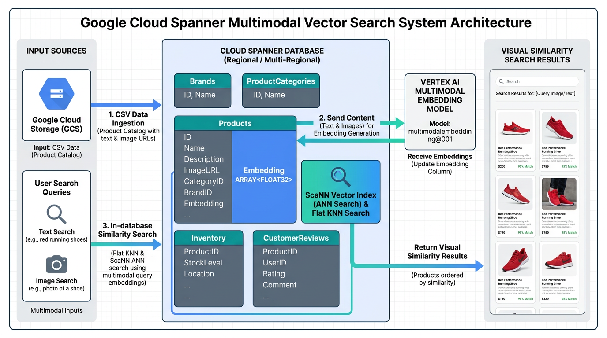
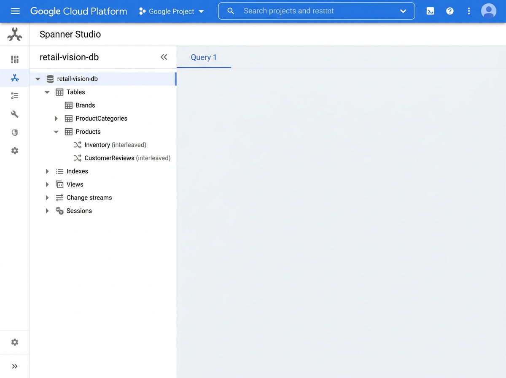
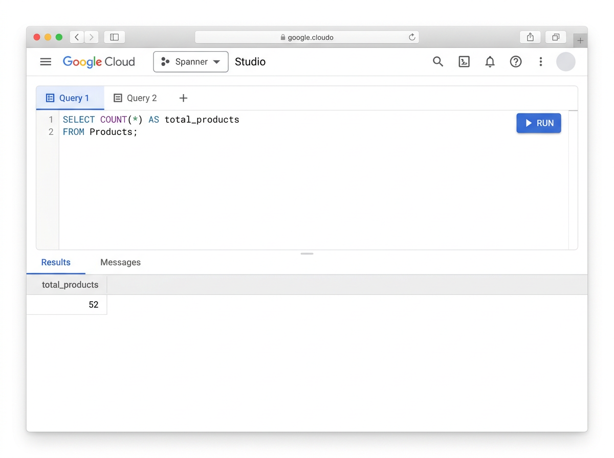

# Enterprise Multimodal Vector Search in Google Cloud Spanner

[](https://cloud.google.com/spanner)
[](https://cloud.google.com/vertex-ai)
[](https://github.com/google-research/google-research/tree/master/scann)
[](https://cloud.google.com/spanner/docs/reference/standard-sql/overview)
[](LICENSE)

An enterprise-ready guide and production reference architecture for building high-performance, real-time **multimodal visual search**, **cross-modal text-to-image similarity**, and **approximate nearest neighbor (ANN) vector indexing** directly within [Google Cloud Spanner](https://cloud.google.com/spanner).

---

## Architecture Overview



### Key Architectural Pillars
1. **Zero-ETL In-Database Multimodal Embeddings**: Cloud Spanner integrates natively with Vertex AI's `multimodalembedding@001` foundation model using `ML.PREDICT`. Embeddings are generated and persisted directly in SQL transactions without extracting rows into separate pipelines or intermediate vector stores.
2. **Unified Relational & Vector Data**: High-dimensional vectors (`ARRAY<FLOAT64>(vector_length=>1408)`) reside directly alongside mission-critical transactional data (`Brands`, `Products`, `Inventory`, and `CustomerReviews`).
3. **Interleaved Tables for Spatial Co-Location**: Child tables (`Inventory`, `CustomerReviews`) are interleaved within parent tables (`Products`) on disk, ensuring single-seek relational joins across availability and inventory metadata.
4. **Google ScaNN Vector Indexing**: Transition seamlessly from exact brute-force scans (`COSINE_DISTANCE`) to logarithmic-time Approximate Nearest Neighbor searches (`APPROX_COSINE_DISTANCE`) powered by Google's state-of-the-art **ScaNN (Score-aware Quantization Loss)** algorithm.
5. **Covering Vector Indexes**: By declaring selective columns in the index's `STORING (...)` clause (including `image_gcs_uri`), Spanner resolves similarity queries entirely within the vector index, eliminating expensive base-table back-joins.

---

## Flat K-NN vs. ScaNN Indexed ANN

| Capability / Metric | Flat K-NN (`COSINE_DISTANCE`) | ScaNN Indexed ANN (`APPROX_COSINE_DISTANCE`) |
| :--- | :--- | :--- |
| **Search Mechanism** | Sequential distributed table scan | Hierarchical ScaNN cluster index tree |
| **Algorithmic Complexity** | $O(N)$ (scales linearly with rows) | $O(\log N)$ (scales sub-linearly/logarithmically) |
| **Query Latency** | Milliseconds on small catalogs; seconds at scale | Milliseconds across millions of vectors |
| **Compute Overhead** | High (evaluates cosine distance across every row) | Minimal (prunes non-candidate clusters) |
| **Recall Accuracy** | 100% exact mathematical recall | 95%+ tunable recall via `num_leaves_to_search` |
| **Best Used For** | Prototyping, small datasets (<50K rows) | Production scale, high-QPS low-latency retail search |

---

## Repository Structure

```text
spanner-multimodal-vector-search-codelab/
├── README.md                          # Architecture overview, quickstart, and deployment guide
├── codelab.md                         # Full Google Codelabs step-by-step tutorial (Sections 1–12)
├── requirements.txt                   # Python dependencies (google-cloud-spanner, google-cloud-storage)
├── .gitignore                         # Standard Python/GCP exclusions
├── LICENSE                            # Apache 2.0 License
├── assets/                            # Architecture diagrams and Spanner Studio console verification
│   ├── spanner_vector_search_architecture.png
│   ├── spanner_studio_tables.png
│   └── spanner_studio_query.png
├── scripts/
│   ├── 01_setup_env_and_iam.sh        # Env variables, API enablement, Service Agent identity & unconditional IAM
│   ├── 02_create_spanner_and_gcs.sh   # Provisions Spanner (ENTERPRISE), Database, GCS bucket & stages 52 media files
│   ├── import_data.py                 # Idempotent Python database seeder (Decimal pricing, RFC 3339 timestamps)
│   └── 99_cleanup.sh                  # Teardown script to delete Spanner instance, GCS bucket, and artifacts
└── sql/
    ├── 01_schema_ddl.sql              # Interleaved relational schema DDL
    ├── 02_models_ddl.sql              # Vertex AI multimodalembedding@001 model definitions
    ├── 03_generate_embeddings_dml.sql # Both Option A (UPDATE ... SET) and Option B (Batched INSERT OR UPDATE)
    ├── 04_flat_knn_queries.sql        # Exact COSINE_DISTANCE similarity queries
    ├── 05_vector_index_ddl.sql        # CREATE VECTOR INDEX ProductsVectorIndex with covering STORING clause
    └── 06_ann_scann_queries.sql       # ScaNN ANN queries with LIMIT 1 CTEs and UNNEST(ARRAY(...)) boundaries
```

---

## Prerequisites

1. **Google Cloud Project** with active billing enabled.
2. **Google Cloud SDK (`gcloud`)** installed and authenticated:
   ```bash
   gcloud auth login
   gcloud auth application-default login
   ```
3. **Python 3.9+** installed:
   ```bash
   python3 -m venv .venv
   source .venv/bin/activate
   pip install -r requirements.txt
   ```

---

## Quickstart Guide

You can run this project in one of two ways:
* **Option 1: Automated Script Execution** (Follow the steps below to provision, seed, and query in minutes).
* **Option 2: Interactive Step-by-Step Codelab** (Follow the comprehensive [codelab.md](codelab.md) guide).

---

### Step 1: Configure Environment & Service Agent IAM

Export your environment variables and execute the setup script:

```bash
export PROJECT_ID="your-google-cloud-project-id"
export REGION="us-central1"   # e.g., us-central1, us-east4, europe-west1, asia-southeast1
export INSTANCE_ID="retail-spanner-instance"
export DATABASE_ID="retail-vision-db"
export BUCKET_NAME="${PROJECT_ID}-retail-multimodal-media"

chmod +x scripts/*.sh
./scripts/01_setup_env_and_iam.sh
```

> [!NOTE]
> The script explicitly provisions the Spanner and Vertex AI Service Agent identities (`gcloud beta services identity create`) and applies unconditional IAM policy bindings (`--condition=None`). If prompted interactively by `gcloud` to choose a condition, select `[3] None`.

---

### Step 2: Provision Spanner, Stage Media & Apply DDL

Run the provisioning script to create an **ENTERPRISE** Spanner instance, a `GOOGLE_STANDARD_SQL` database, stage the 52 catalog images, and apply the schema and Vertex AI model DDLs:

```bash
./scripts/02_create_spanner_and_gcs.sh
```

---

### Step 3: Ingest Catalog & Inventory Data

Run the idempotent Python seeding script:

```bash
python3 scripts/import_data.py
```

Inspect the database in **Spanner Studio**:



Verify that 52 products were inserted with `image_embedding` currently set to `NULL`:

```sql
SELECT COUNT(*) AS total_products FROM Products;
```



---

### Step 4: Generate In-Database Multimodal Embeddings

Execute either **Option A** or **Option B** from `sql/03_generate_embeddings_dml.sql`:

#### Option A: Direct `UPDATE ... SET` (Recommended for Small-to-Medium Tables)
```sql
UPDATE Products
SET image_embedding = (
  SELECT p.imageEmbedding
  FROM ML.PREDICT(
    MODEL ImageEmbeddings,
    (SELECT STRUCT(image_gcs_uri AS gcsUri) AS image)
  ) AS p
)
WHERE image_embedding IS NULL;
```

#### Option B: Batched `INSERT OR UPDATE INTO ... SELECT` with `LIMIT` (For Large Tables)
```sql
INSERT OR UPDATE INTO Products (
  product_id, brand_id, category_id, name, description, color, list_price, image_gcs_uri, image_embedding
)
SELECT
  product_id, brand_id, category_id, name, description, color, list_price, image_gcs_uri,
  imageEmbedding AS image_embedding
FROM ML.PREDICT(
  MODEL ImageEmbeddings,
  (
    SELECT
      product_id, brand_id, category_id, name, description, color, list_price, image_gcs_uri,
      STRUCT(image_gcs_uri AS gcsUri) AS image
    FROM Products
    WHERE image_embedding IS NULL
    LIMIT 20
  )
);
```

Verify that all embeddings have 1408 dimensions:
```sql
SELECT product_id, name, ARRAY_LENGTH(image_embedding) AS dims
FROM Products
WHERE image_embedding IS NOT NULL
LIMIT 5;
```

---

### Step 5: Exact Vector Similarity Search (Flat K-NN)

Execute queries from `sql/04_flat_knn_queries.sql`.

#### Pattern 1: Catalog Image-to-Image Search
Find visually similar products compared to `prod_001` (Joan Ellis Women's Crop Pant):
```sql
SELECT 
  p.product_id, 
  p.name, 
  p.list_price, 
  COSINE_DISTANCE(p.image_embedding, target.image_embedding) AS distance
FROM Products AS p,
(SELECT image_embedding FROM Products WHERE product_id = 'prod_001') AS target
WHERE p.product_id <> 'prod_001' AND p.image_embedding IS NOT NULL
ORDER BY distance ASC
LIMIT 5;
```

#### Pattern 2: Ad-Hoc Uploaded GCS Image Search
Search against an external uploaded image without inserting it into the database:
```sql
SELECT 
  p.product_id, 
  p.name, 
  p.list_price, 
  p.image_gcs_uri,
  COSINE_DISTANCE(p.image_embedding, query_emb.imageEmbedding) AS distance
FROM Products AS p
CROSS JOIN (
  SELECT p_emb.imageEmbedding
  FROM ML.PREDICT(
    MODEL ImageEmbeddings,
    (SELECT STRUCT('gs://YOUR_BUCKET/query-images/sample_query_bed.png' AS gcsUri) AS image)
  ) AS p_emb
) AS query_emb
WHERE p.image_embedding IS NOT NULL
ORDER BY distance ASC
LIMIT 5;
```

#### Pattern 3: Hybrid Cross-Modal Text-to-Image Search
Search by text prompt (*"comfortable casual cropped pants"*), joined with brand and in-stock store inventory:
```sql
SELECT 
  p.product_id, 
  p.name, 
  b.brand_name, 
  b.tier, 
  p.list_price, 
  inv.stock_count,
  COSINE_DISTANCE(p.image_embedding, query_emb.textEmbedding) AS distance
FROM Products AS p
JOIN Brands AS b ON p.brand_id = b.brand_id
JOIN Inventory AS inv ON p.product_id = inv.product_id
CROSS JOIN (
  SELECT p_emb.textEmbedding
  FROM ML.PREDICT(
    MODEL TextMultimodalEmbeddings,
    (SELECT 'comfortable casual cropped pants' AS text)
  ) AS p_emb
) AS query_emb
WHERE inv.store_id = 'store_nyc'
  AND inv.stock_count > 0 
  AND p.image_embedding IS NOT NULL
ORDER BY distance ASC
LIMIT 5;
```

---

### Step 6: Create the ScaNN Vector Index & Monitor Backfill

Apply the covering vector index from `sql/05_vector_index_ddl.sql`:

```sql
CREATE VECTOR INDEX ProductsVectorIndex
ON Products(image_embedding)
STORING (name, color, list_price, brand_id, category_id, image_gcs_uri)
WHERE image_embedding IS NOT NULL
OPTIONS (distance_type = 'COSINE');
```

Monitor index state until it reaches `READ_WRITE`:
```sql
SELECT table_name, index_name, index_state, index_type
FROM INFORMATION_SCHEMA.INDEXES
WHERE index_name = 'ProductsVectorIndex';
```

---

### Step 7: Optimized ANN Searches with ScaNN

Execute queries from `sql/06_ann_scann_queries.sql`.

> [!IMPORTANT]
> **Golden Rules of Spanner's Vector Index Optimizer:**
> 1. Always include `LIMIT 1` on vector-generating CTEs (`target` / `query_emb`) so Spanner proves single-row cardinality (`MaxCard = 1`).
> 2. Wrap forced vector index scans (`Products @{force_index=ProductsVectorIndex}`) inside an `UNNEST(ARRAY(SELECT AS STRUCT ...)) AS m` materialization boundary when combining with outer `WHERE` predicates or relational joins. This prevents optimizer filter/join pushdown before `ORDER BY APPROX_COSINE_DISTANCE(...)`.

#### Pattern 1: Catalog Image-to-Image ANN Search
```sql
WITH target AS (
  SELECT image_embedding 
  FROM Products 
  WHERE product_id = 'prod_001' 
  LIMIT 1
)
SELECT m.product_id, m.name, m.list_price, m.distance
FROM UNNEST(ARRAY(
  SELECT AS STRUCT
    p.product_id, 
    p.name, 
    p.list_price, 
    APPROX_COSINE_DISTANCE(p.image_embedding, target.image_embedding, OPTIONS => JSON '{"num_leaves_to_search": 20}') AS distance
  FROM Products @{force_index=ProductsVectorIndex} AS p, target
  WHERE p.image_embedding IS NOT NULL
  ORDER BY distance ASC
  LIMIT 6
)) AS m
WHERE m.product_id <> 'prod_001'
ORDER BY m.distance ASC
LIMIT 5;
```

#### Pattern 3: Hybrid Cross-Modal Text-to-Image ANN Search
```sql
WITH query_emb AS (
  SELECT p_emb.textEmbedding
  FROM ML.PREDICT(
    MODEL TextMultimodalEmbeddings,
    (SELECT 'comfortable casual cropped pants' AS text)
  ) AS p_emb
  LIMIT 1
)
SELECT 
  m.product_id, 
  m.name, 
  b.brand_name, 
  b.tier,
  m.list_price, 
  inv.stock_count,
  m.distance
FROM UNNEST(ARRAY(
  SELECT AS STRUCT
    p.product_id, 
    p.brand_id,
    p.name, 
    p.list_price, 
    APPROX_COSINE_DISTANCE(p.image_embedding, query_emb.textEmbedding, OPTIONS => JSON '{"num_leaves_to_search": 20}') AS distance
  FROM Products @{force_index=ProductsVectorIndex} AS p, query_emb
  WHERE p.image_embedding IS NOT NULL
  ORDER BY distance ASC
  LIMIT 10
)) AS m
JOIN Brands AS b ON m.brand_id = b.brand_id
JOIN Inventory AS inv ON m.product_id = inv.product_id
WHERE inv.store_id = 'store_nyc'
  AND inv.stock_count > 0
ORDER BY m.distance ASC
LIMIT 5;
```

---

### Step 8: Clean Up Resources

To avoid incurring ongoing charges for Cloud Spanner compute and Cloud Storage objects, run:

```bash
./scripts/99_cleanup.sh
```

---

## References & Further Reading

* [Image Similarity Search: Two Approaches in Google Cloud Spanner](https://medium.com/@rishi.dba) by Rishi Kapoor
* [Google Cloud Spanner Vector Search Part 2: Transitioning to ANN Indexes (Comprehensive Guide)](https://medium.com/@rishi.dba/google-cloud-spanner-vector-search-part-2-transitioning-to-ann-indexes-comprehensive-guide-49459d2a355e) by Rishi Kapoor
* [Google Cloud Spanner Vector Search Documentation](https://cloud.google.com/spanner/docs/vector-search)
* [Vertex AI Multimodal Embeddings Reference](https://cloud.google.com/vertex-ai/docs/generative-ai/embeddings/get-multimodal-embeddings)
* [Google Research: ScaNN (Score-aware Quantization Loss)](https://github.com/google-research/google-research/tree/master/scann)
